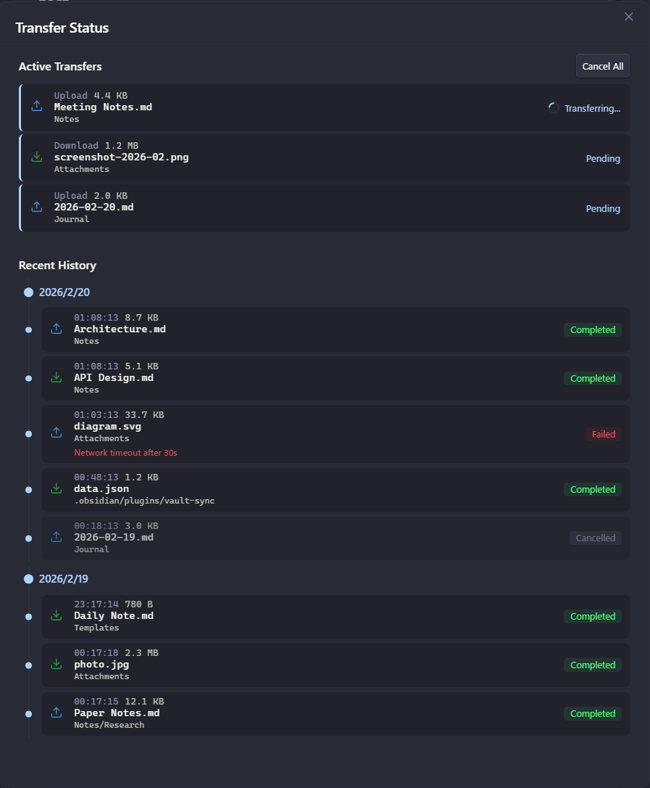
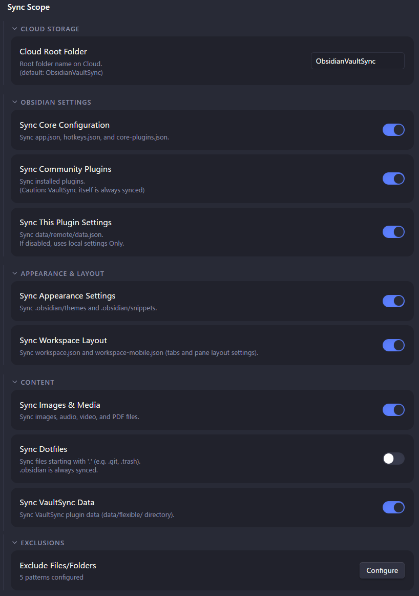
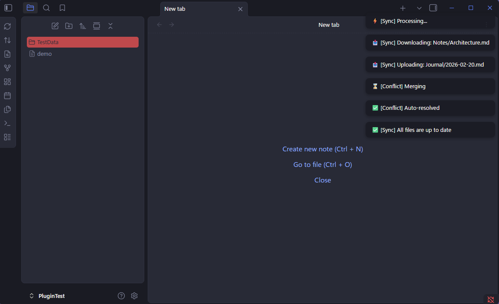
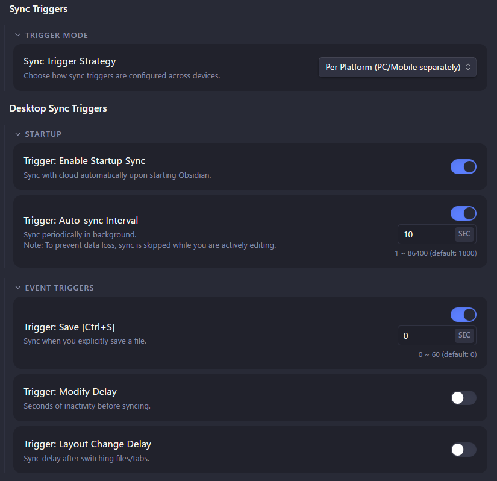
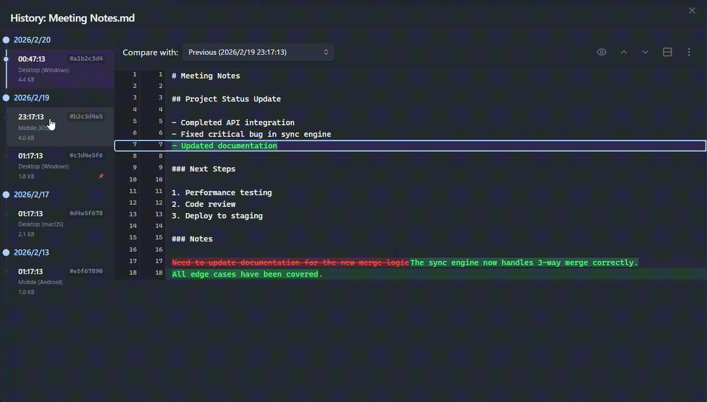
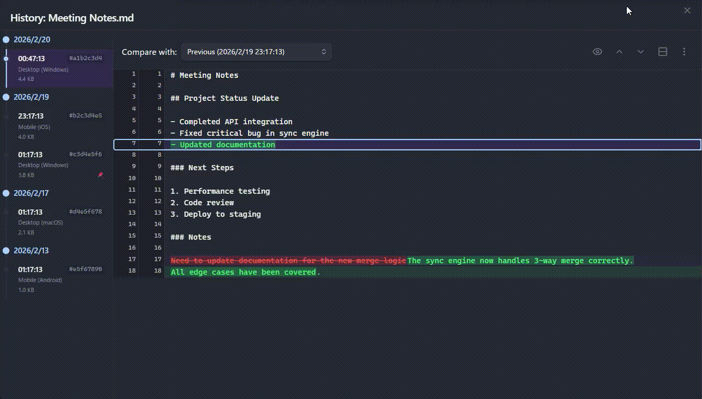
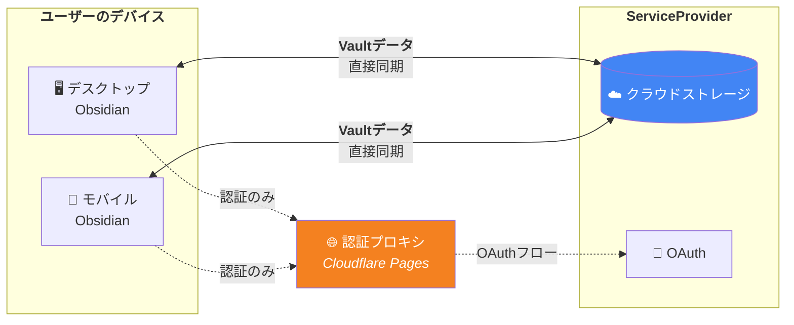
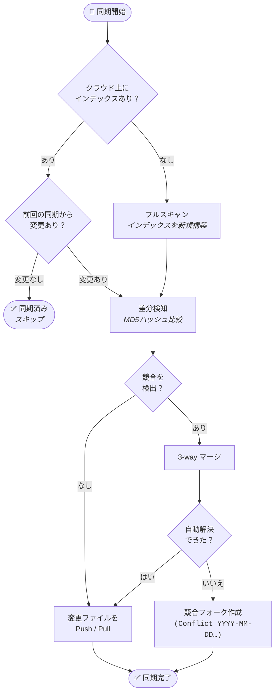
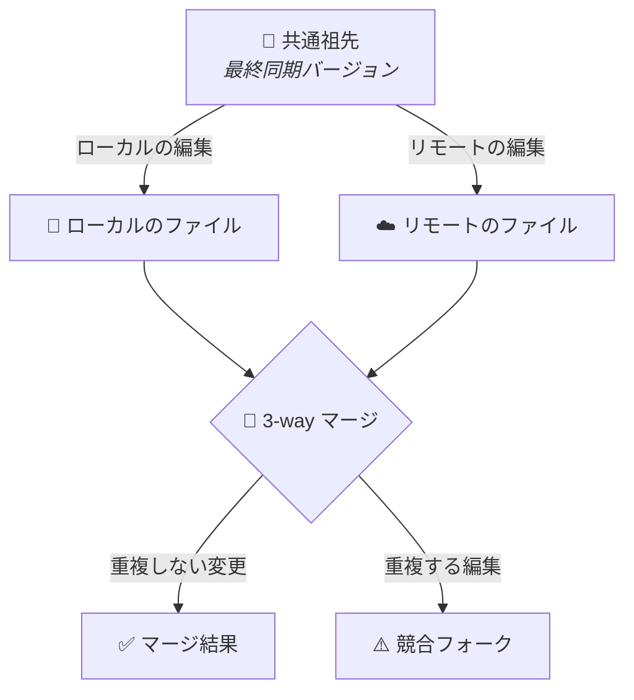
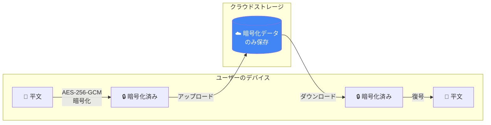

<p align="center">
  
</p>

<p align="center">
  <b>Cloud sync plugin for Obsidian</b>
</p>

<p align="center">
  <a href="README.md">🇺🇸 English</a> | <a href="README_ja.md">🇯🇵 日本語</a>
</p>

<p align="center">
  <a href="https://opensource.org/licenses/MIT"></a>
  <a href="https://github.com/c-ardinal/obsidian-vault-syncer/releases"></a>
  <a href="https://github.com/c-ardinal/obsidian-vault-syncer/actions/workflows/test.yml"></a>
  
</p>

Obsidian向けの高速・インテリジェントなクラウドストレージ同期プラグインです。
クラウドストレージを活用し、PCとモバイルデバイス（iOS/Android）間での強固なデータ一貫性と高速な同期体験を提供します。
現在の対応クラウドストレージは以下です。動作には Obsidian 1.11.4 以降が必要です。

- [x] Google Drive

---

## ✨ 主な特徴

- **インテリジェント同期 (Index Shortcut)**:
    - MD5ハッシュ計算とObsidian標準のファイル変更検知機能を併用し、Vault内の全変更を高速かつ効率的に検知。ドットファイルの変更も検知可能。
- **スマート・マージ (3-way Merge)**:
    - 複数デバイスでの同時編集や同期タイミングなどの要因で競合が発生した際も、ロック制御で安全に保護しつつ、可能な限り自動マージを実行する。
    - Canvas・JSON・Bases ファイルはデータ構造単位でマージするため、マージ結果が破損して読込不能になることはない。
- **履歴・差分表示 (Revision History)**:
    - クラウドストレージ上のファイルリビジョンを取得し、ローカルとの差分表示や過去バージョンの復元が可能。
- **モバイル最適化**:
    - デスクトップ/モバイル（iOS/Android）の両方で、同一機能が動作。
    - 編集停止時や保存時の自動同期、レイアウト変更トリガー（タブ移動時）を搭載。アプリの非表示化・終了時にも、未送信の変更を即時送信する。
    - 大容量ファイルの転送は、Wi-Fi接続時または電池残量の回復時まで延期可能（Android・PC）。
- **詳細な同期設定**:
    - `.obsidian` 内の設定、プラグイン、外観、ホットキーなどの同期可否を個別に選択可能。キャッシュや一時ファイルは自動で除外される。
    - 除外パターン、ファイルサイズ上限、`.obsidian` 内の同期可否は、PC・モバイル別の設定にも対応。
- **データ保護・復元**:
    - クラウド上で削除されたファイルを指定日数保管し、復元可能。Vault全体またはフォルダ単位で、過去時点への復元にも対応。
    - 大量のファイルの削除、またはクラウド上の大量のファイルの上書きを実行する同期は、事前に確認を要求する。
- **同期状況の確認・診断**:
    - 同期端末の一覧と各端末の変更履歴の表示、本端末とクラウドの同期状態の検証、サポート依頼用の診断情報の取得が可能。
- **安全な認証 & 保存**:
    - 内蔵の認証プロキシ（設定不要）または独自の Client ID/Secret（PKCE対応）によるOAuth2認証。
    - 認証情報は設定ファイルから分離し、ObsidianのSecretStorage APIに安全に保存される。
- **バックグラウンド転送**:
    - 大容量ファイルはUIをブロックせず、バックグラウンドでアップロード・ダウンロード。閾値と同時接続数を設定可能。
- **エンドツーエンド暗号化 (E2EE)**:
    - [E2EE Engine](https://github.com/c-ardinal/obsidian-vault-syncer-e2ee-engine) を別途導入すると、Vault内のデータの暗号化が可能。ファイル内容をアップロード前に暗号化、ダウンロード後に復号するため、クラウド上に平文の内容は残存しない。ファイル名・フォルダ名は暗号化の対象外。

|               転送ステータス               |                   選択的同期                    |
| :----------------------------------------: | :---------------------------------------------: |
|  |  |

---

## 📖 使用方法

### 同期の実行

- **手動同期**:
    - **リボンアイコン**:
        - 画面左側のツールバーにある同期アイコンをクリックすると、スマート同期を開始する。
    - **コマンドパレット**:
        - `Ctrl+P` (または `Cmd+P`) を押下し、`Vault Syncer: 即時同期` を選択する。
- **自動同期**:
    - 設定に応じて、起動時、ファイル保存時、編集停止時、レイアウト変更時、一定間隔で自動同期を実行する。
- **その他のコマンド**:
    - コマンドパレットから、以下の画面も表示可能。

| コマンド                                             | 表示内容                                       |
| :--------------------------------------------------- | :--------------------------------------------- |
| `Vault Syncer: 同期状況の詳細を表示`                 | 同期状態、未送信の変更、各画面への移動         |
| `Vault Syncer: 転送状況を表示`                       | 実行中・完了済みのアップロードとダウンロード   |
| `Vault Syncer: 競合解決画面を表示`                   | 競合コピーの比較と解決                         |
| `Vault Syncer: 保管中の削除ファイルを表示`           | クラウド上で保管中の削除ファイルと復元操作     |
| `Vault Syncer: 過去時点への復元画面を表示`           | 指定時点へのVaultの復元                        |
| `Vault Syncer: 同期端末と変更履歴を表示`             | Vaultを同期中の端末と直近の変更                |
| `Vault Syncer: 本端末とクラウドの同期状態の検証`     | 本端末とクラウドの比較（読取専用）             |
| `Vault Syncer: 本端末の同期対象外ファイルの個別取得` | 本端末で同期対象外のファイルの個別ダウンロード |
| `Vault Syncer: 診断情報を表示`                       | コピー・報告用の診断情報                       |
| `Vault Syncer: アドオン導入画面を表示`               | アドオンの導入画面                             |

|             同期通知              |                 同期トリガー設定                  |
| :-------------------------------: | :-----------------------------------------------: |
|  |  |

### 履歴と復元

- **ファイル履歴**:
    - ファイルを右クリックし、「バージョン履歴を表示 (Vault Syncer)」を選択すると、クラウドストレージ上の過去リビジョンとの比較が可能。
- **高機能diffビューア**:
    - Unified/左右分割表示の選択、行内差分のハイライト、差分箇所へのジャンプ機能（ループ対応）、表示コンテキスト行数の動的調整など、強力な比較機能を提供する。
- **フルスキャン**:
    - 整合性に懸念がある際は、コマンドパレットから `Vault Syncer: 完全スキャンを実行` を実行し、同期状態を強制的にチェック可能。

|              クラウド履歴              |             Diffビューア             |
| :------------------------------------: | :----------------------------------: |
|  |  |

---

## 📦 インストール

### コミュニティプラグイン (推奨)

1. Obsidianの設定 > コミュニティプラグインを表示する。
2. コミュニティプラグインの「閲覧」をクリックする。
3. 検索欄に「Vault Syncer」と入力して、「インストール」をクリックする。
4. 設定 > コミュニティプラグインに復帰し、「Vault Syncer」を有効化する。

### BRAT 経由

1. Obsidian のコミュニティプラグインから [BRAT](https://github.com/TfTHacker/obsidian42-brat) をインストールする。
2. BRAT の設定を表示し、**「Add Beta plugin」** をクリックする。
3. `c-ardinal/obsidian-vault-syncer` と入力し、`Latest version`を選択して、**「Add Plugin」** をクリックする。
4. 設定 > コミュニティプラグインから「Vault Syncer」を有効化する。

BRAT が自動的にアップデートを確認し、プラグインを最新状態に維持する。

### 手動インストール

1. [最新リリース](https://github.com/c-ardinal/obsidian-vault-syncer/releases/latest)から `main.js`、`manifest.json`、`styles.css` をダウンロードする。
2. Vault の `.obsidian/plugins/` ディレクトリに `cardinal-vault-syncer` フォルダを作成する。
3. ダウンロードしたファイルをフォルダに配置する。
4. 設定 > コミュニティプラグインから「Vault Syncer」を有効化する。

---

## 🚀 ログイン手順

Vault Syncer には3種類の認証方式がある。用途に応じて選択する。

### 方法A: デフォルト（推奨）

最もシンプルな方法。開発者提供の認証プロキシを使用してOAuthログインを実行する。Google Cloud の設定は不要。

1. Obsidian の設定 > 「Vault Syncer」 > 「認証」を表示する。
2. ログイン方式が **「デフォルト（推奨）」** であることを確認する。
3. **「ログイン」** ボタンを押下する。
4. ブラウザが起動し、Googleのログイン画面が表示される。
5. ログインに成功すると自動的にObsidianへ復帰する。認証成功の通知が表示されれば完了。
    - Obsidianへ自動復帰しない際は、ブラウザ画面に表示される「Open Obsidian」ボタンを押下する。
    - ボタン押下後も復帰しない際は、手動でObsidianアプリに移動する。
6. ログイン直後に初回同期が開始される。再起動は不要。

> **補足**: 認証プロキシはOAuth認可コードとトークンを一時的（メモリ上のみ）に処理し、処理完了後は破棄する。Vault内のデータがプロキシを経由することはない。詳細は[プライバシーポリシー](https://obsidian-vault-sync.pages.dev/privacy/)を参照。

### 方法B: カスタム認証プロキシ

デフォルトの認証プロキシに代替して、独自の認証プロキシサーバーを使用する方法。

1. Vault Syncer API互換の認証プロキシをデプロイする（リファレンス実装は `www/functions/` ディレクトリを参照）。
2. Obsidian の設定 > 「Vault Syncer」 > 「認証」を表示する。
3. ログイン方式を **「別の認証プロキシを使用」** に変更する。
4. プロキシのURL（HTTPS必須）を入力する。
5. **「ログイン」** ボタンを押下し、Googleのログインフローを完了する。ログイン直後に初回同期が開始される。

### 方法C: Client ID / Secret

完全なコントロールが必要な際は、独自のGoogle Cloud Projectを作成し、独自のOAuth認証情報を使用可能。この方式では、Cloudflare Pages上のコールバックページは認証コードを `obsidian://` プロトコル経由でObsidianに転送するリダイレクトリレーとしてのみ使用される。トークン交換はプラグインがGoogleと直接実行し、認証情報やトークンがプロキシを経由することはない。

#### 1. Google Cloud Project の作成

1. [Google Cloud Console](https://console.cloud.google.com/) にアクセスする。
2. 新規プロジェクトを作成する。
3. 「APIとサービス」 > 「ライブラリ」から **Google Drive API** を検索し、「有効にする」を押下する。

#### 2. OAuth 同意画面の設定

1. **OAuth 同意画面の作成**:
    1. 「APIとサービス」 > 「OAuth 同意画面」 > 「概要」から「開始」を押下する。
    2. アプリ情報を入力する。User Type は「外部」を選択する。
    3. 全項目の記入後、「作成」を押下する。
2. **スコープの追加**:
    1. 「データアクセス」から「スコープを追加または削除」を選択する。
    2. `.../auth/drive.file` （このアプリで使用する Google ドライブ上の特定のファイルのみの参照、編集、作成、削除）をチェックする。
    3. 「更新」を押下する。
    4. 画面下部の「Save」を押下する。
3. **認証期間の永続化**:
   プロジェクトが「テスト状態」の間は、7日周期で再ログインが必要。
   再ログイン不要で継続利用するにはプロジェクトを「公開状態」に変更する必要があるが、利用規約・プライバシーポリシー等を準備した上で、Googleの審査に合格する必要がある。慎重に対応すること。

#### 3. 認証情報 (Client ID / Secret) の作成

1. 「APIとサービス」 > 「認証情報」 > 「認証情報を作成」 > 「OAuth クライアント ID」を選択する。
2. アプリケーションの種類として **「ウェブ アプリケーション」** を選択する。
3. 「承認済みのリダイレクト URI」から「URIを追加」を押下する。
4. `https://obsidian-vault-sync.pages.dev/api/auth/callback` と入力する。
    - これはGoogleからの認証コードを受信し、`obsidian://` プロトコルでObsidianアプリに転送するリダイレクトリレーである。トークンや認証情報が上記URLのサーバに保存されることはない。
5. 「作成」を押下する。
6. 生成された **クライアント ID** と **クライアント シークレット** をコピーする。
    - **重要**: クライアントシークレットは機密情報である。第三者には絶対に開示しないこと。

#### 4. プラグインへの反映

1. Obsidian の設定 > 「Vault Syncer」 > 「認証」を表示する。
2. ログイン方式を **「Client ID / Secret を使用」** に変更する。
3. IDとシークレットを入力し、**「ログイン」** ボタンを押下する。
4. ブラウザが起動し、Googleのログイン画面が表示される。
5. ログインに成功すると自動的にObsidianへ復帰する。認証成功の通知が表示されれば完了。
    - Obsidianへ自動復帰しない際は、ブラウザ画面に表示される「Open Obsidian」ボタンを押下する。
    - ボタン押下後も復帰しない際は、手動でObsidianアプリに移動する。
6. ログイン直後に初回同期が開始される。再起動は不要。

---

## 📒アーキテクチャ



> **Vaultデータは常にデバイスとクラウドストレージ間で直接転送される。**
> 認証プロキシはOAuthログイン時のみ使用し、独自のClient IDの使用によりバイパスも可能。

---

## 🔧 同期エンジンの仕様

### スマート同期フロー



### 3-way マージ

同一ファイルが複数デバイスで編集された際は、共通祖先を基準に3-wayマージで競合を解決する。



### その他の仕様

- **競合解決戦略**: 「スマートマージ」「コピーを作成」「本端末を優先」「クラウドを優先」の戦略を選択可能。自動解決が不可能な際は、ローカルファイルを `(Conflict YYYY-MM-DDTHH-mm-ss)` のコピーとして保持し、競合解決画面から後日解決可能。
- **選択的同期**: `.obsidian/` 内のファイル（プラグイン、テーマ、ホットキー等）をカテゴリ別に同期制御可能。`workspace.json` や `cache/` など、デバイス固有のデータは自動的に除外される。
- **デバイス間通信**: `communication.json` を介してデバイス間でマージロックを制御し、同一ファイルの同時編集による上書きを防止する。
- **アトミック更新**: ファイル単位の転送完了時に、個別のインデックスエントリを更新。インデックスはGzip圧縮され、効率的に同期される。

---

## 📣 開示事項

Obsidian の開発者ポリシーに準拠した開示:

- **アカウントが必要**: Vault をユーザ自身の Google Drive に同期するため、Google アカウントが必要。
- **ネットワーク通信**: 通信先は以下のみで、用途は Vault の同期とログインに限定する。
    - Google Drive API（`www.googleapis.com`）: ユーザ自身の Google Drive 上で Vault のファイルをアップロード・ダウンロード・一覧取得する。
    - Google ログイン（`accounts.google.com`、`oauth2.googleapis.com`）: OAuth ログインとトークン更新。
    - Vault Syncer 認証プロキシ（`obsidian-vault-sync.pages.dev`、Cloudflare Pages）: デフォルトのログイン方法で OAuth ログインを完了させる。Vault のデータは経由しない。独自の Client ID / Secret（方法C）や独自のプロキシ（方法B）を使用すれば、本プロキシ自体も経由しない。詳細は[プライバシーポリシー](https://obsidian-vault-sync.pages.dev/privacy/)を参照。
    - GitHub（`github.com`）: アドオン導入時の「ダウンロードページへ移動」、または診断情報画面の「GitHub で報告」を押下した際のみ、ブラウザで表示する。後者は同画面に表示中の診断情報を Issue 投稿画面に記入済の状態で表示するため、表示時点で診断情報はリンクの一部として GitHub に送信される。Issue として公開されるのは、ユーザが投稿した時点。プラグイン自体がコードをダウンロードすることはない。
- **テレメトリ・広告・課金なし**: 利用状況の収集や広告表示は実施しない。無料のオープンソース（MIT）。

---

## 🔒 プライバシーとセキュリティ

- **直接通信**:
    - 全Vaultデータはデバイスとクラウドストレージ間で直接同期される。認証プロキシやサードパーティサーバーを経由してVaultの内容が送信されることはない。
- **認証プロキシ**:
    - デフォルトでは、本プラグインは [Cloudflare Pages](https://www.cloudflare.com/) 上にホストされた認証プロキシを使用してOAuthログインフローを仲介する。このプロキシはOAuth認可コードとトークンを**一時的に**（メモリ上のみで永続化せず）処理する。独自の Client ID / Client Secret の設定により、このプロキシの使用を回避可能。詳細は[プライバシーポリシー](https://obsidian-vault-sync.pages.dev/privacy/)を参照。
- **認証保護**:
    - トークンや暗号化シークレットなどの機密情報は、ObsidianのSecretStorage APIを介して保管される。これにより、機密情報を包含するファイルのVault内への残存を最小限に抑制する。なお、SecretStorageが利用不可能な環境では、デバイス固有の秘密鍵（AES-GCM）で暗号化したローカルファイル保存へ自動的にフォールバックし、安全性を維持する。
- **データの所在**:
    - 同期されたデータは、ユーザ自身のクラウドストレージ領域（指定したルートフォルダ）のみに保存される。
- **ファイル暗号化**:
    - デフォルトでは、同期されるデータ（Markdownファイル等）はクラウドストレージへ**平文（暗号化なし）でアップロードされる**。クラウドストレージ自体のセキュリティモデル（HTTPS転送、サーバー側暗号化）で保護されるが、サーバー側でのデータ閲覧は可能。エンドツーエンド暗号化が必要な際は、[Vault Syncer E2EE Engine](https://github.com/c-ardinal/obsidian-vault-syncer-e2ee-engine) を導入すること。詳細は後述のセクションを参照。

---

## 🔑 エンドツーエンド暗号化 (E2EE)

Vault Syncer は、別途公開中のオープンソース暗号化エンジンを介して、オプションでエンドツーエンド暗号化に対応している。



E2EE 有効時の動作:

- 全ファイルが **アップロード前にデバイス上で AES-256-GCM により暗号化** される
- ダウンロード後は **ローカルで復号** され、クラウドストレージ側がファイル内容を参照することはない
- ファイル名・フォルダ名・サイズ・更新日時は暗号化の**対象外**
- ファイルはランダム生成のマスターキーで暗号化される。`vault-lock.vault` ファイルが同キーを保持し、パスワードから PBKDF2 で導出した鍵で保護する
- スマート同期機能（3-way マージ、競合検出）は暗号化データでもシームレスに動作する
- パスワードを ObsidianのSecretStorageに保存し、自動ロック解除も可能
- データの再暗号化なしでパスワードを変更可能
- マスターキーを Base64 文字列としてエクスポートし、パスワード紛失時の復旧に使用する**リカバリーコードを生成可能**
- 設定閾値以上のファイルでピークメモリを削減しつつ、**大容量ファイルのストリーミング暗号化** を実現する

E2EE Engineは、暗号化を希望するユーザーのみが自身の意思で導入可能なように、独自の利用条件を持つ**アドオン**として別途配布されている。PC・スマートフォンとも、非表示フォルダ `.obsidian` を操作せず、数タップで導入可能:

1. Vault Syncerの設定画面「アドオン」の **アドオンを導入...** をタップする（またはコマンドパレットから `Vault Syncer: アドオン導入画面を表示` を実行）。
2. **ダウンロードページへ移動** をタップし、最新リリースの `vault-syncer-e2ee-engine.zip` をダウンロードする。
3. **ファイルを選択** でダウンロードしたzipを選択する。Vault Syncerが内部の全ファイルを承認済みリリースと照合する（SHA-256）。
4. ダイアログに表示されるアドオンの利用条件を確認して同意し、**導入する** をタップする。再起動不要で有効化される。
5. 以後、Vault Syncerの設定画面「アドオン」にアドオン固有の設定ページが表示される。アドオンの各操作は、同ページとコマンドパレットの双方から実行可能。

Vault Syncer自体がアドオンをダウンロードすることはない。他デバイスでアドオンを使用中のVaultでは、起動時に導入ダイアログを表示し、導入後は直接パスワード入力に移行する。従来同様 `e2ee-engine.js` を `.obsidian/plugins/cardinal-vault-syncer/` へ手動でコピーする方法も使用可能。

詳細、利用可能なコマンド、ビルド手順、暗号化仕様については **[Vault Syncer E2EE Engine リポジトリ](https://github.com/c-ardinal/obsidian-vault-syncer-e2ee-engine)** を参照。

---

## 🛠 開発とビルド

開発環境での実行、またはソースからのビルド手順：

### ビルド

```bash
npm run build
```

ビルド結果は `dist/cardinal-vault-syncer/` ディレクトリ配下に以下の形式で出力される。
配布時はこのフォルダの内容をプラグインフォルダへコピーする。

- `main.js`
- `manifest.json`
- `styles.css`

---

## ⚠️ 免責事項

### データ損失リスク

本プラグインはデータの同期を自動化するが、ネットワークエラーや予期せぬ競合によるデータ損失のリスクを完全に排除するものではない。**本プラグインの使用によって生じたいかなる損害（データ消失、Vaultの破壊など）についても、作者は一切の責任を負わない。** 重要なデータについては、本プラグインの導入前に必ずバックアップを取得し、導入後も定期的なバックアップを継続すること。
詳細は[利用規約](https://obsidian-vault-sync.pages.dev/tos/)を参照。

### 複数端末での同時編集・同時操作

本プラグインは、複数端末間で Vault を同期するためのプラグインであり、複数端末で同一ファイルを同時に編集するためのプラグインではない。同時編集を検出した際の保護処理（自動マージ、競合コピーの保存、上書き検出後の修復）は実装済みだが、**完全な保護を保証するものではなく、意図しない上書きや編集内容の消失が発生する可能性がある。** 別の端末で編集を開始する際は、事前に同期の完了を確認することを推奨する。

Vault 全体を対象とする操作（アドオンの初期設定など）は、1 台の端末でのみ実行し、完了まで他端末で同一の操作を開始しないこと。クラウドストレージは排他制御の手段を提供しないため、複数端末による完全な同時実行は排除不可能で、Vault の不整合が発生する可能性がある。

### 複数ユーザでの利用

本プラグインの同期/マージ機能は**単一ユーザーの編集内容を、複数デバイス間で同期すること**を想定して開発されている。**複数ユーザーが同一Vaultで同時編集した内容を同期する** といった用途は想定外である。予め了承のこと。

---

## ❓ よくある質問 (FAQ)

**Q: 同期アイコンの回転が停止しない。**
A: 大量のファイルを同期中か、ネットワークが不安定な可能性がある。
通知レベルを詳細に変更するか、設定画面からログ出力を有効化して詳細を確認すること。

**Q: 特定のフォルダ・ファイルを同期対象から除外したい。**
A: 設定の「同期範囲」内「除外ファイル/フォルダ（全端末共通）」に、除外対象のフォルダやファイル名をglobパターンで追加する。
例として`secret/**`を設定すると、`secret`フォルダおよび配下のファイルが同期対象外になる。

**Q: モバイル端末で認証後にアプリへ復帰しない。**
A: ブラウザのセキュリティ設定により、自動復帰が不可能なケースがある。
認証完了画面が表示されたら、手動でObsidianアプリに移動する。
再度認証が完了しない際は、設定画面からログイン方式を変更（例：「Client ID / Secret を使用」）して再試行する。

**Q: 通常は同期される変更内容が、特定の時点から同期されなくなった。**
A: 認証情報が失効している可能性がある。設定画面から認証情報を再設定すること。

**Q: E2EE有効時も、同期/マージ機能は正常に動作するか？**
A: 正常に動作する。E2EE Engineは、暗号化されたデータに対して3-wayマージアルゴリズムを適用し、競合を検出・解決する。スマート同期機能も暗号化データに対してシームレスに動作する。

## ライセンス

MIT License
